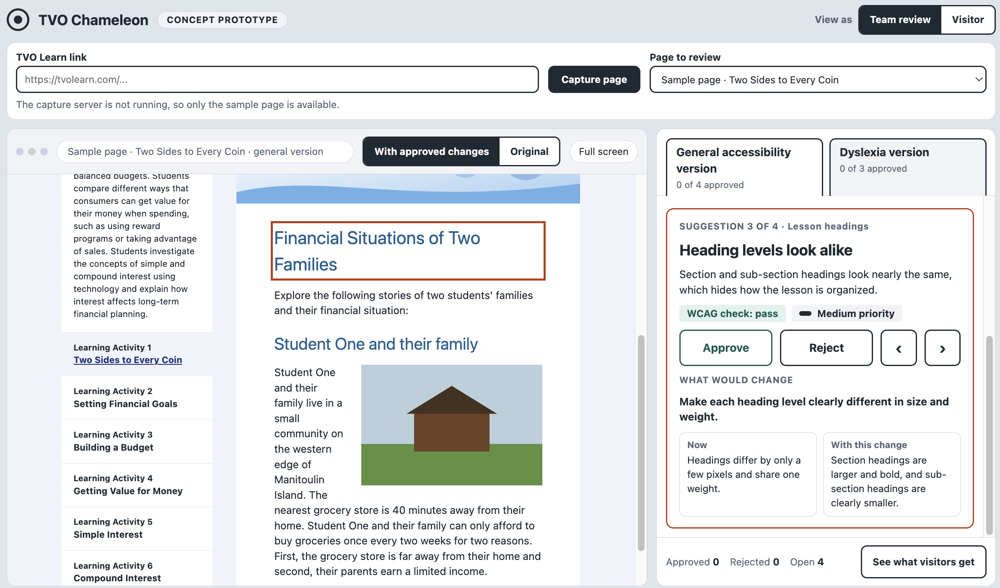

# TVO_Chameleon
Group 4 repo for FTL 2026

## About the project

TVO Chameleon is a cognitive accessibility tool for TVO content creators and designers. It analyzes
selected webpage content (text, educational materials and layout) and finds gaps in cognitive
accessibility, measured against age-appropriate standards for Grade 3–5 students, with an optional
focus on students with dyslexia. It then gives recommendations to improve accessibility. A reviewer
accepts, edits or rejects each one, and the tool produces adapted content with the accepted changes.



### Purpose

The goal is to help TVO find and remove barriers in its educational webpages for Grade 3–5 students,
starting with dyslexia. The tool:

- analyzes text, educational content and page layout
- gives actionable, evidence-informed recommendations
- with human approval, generates adapted content that is clearer and easier to use, while keeping the
  curriculum learning objectives

By building accessibility checks into the content design and review process, the project aims to help
TVO make more inclusive resources, so more students can access, understand and benefit from its free,
curriculum-aligned learning materials. The tool supports human judgment and does not replace it. It
could later be extended to other cognitive and learning needs.

## Quick start

The fastest way to see the tool is the client on its own, using the built-in sample page
(`client/public/sample-page.html`). It needs only Node.js 18 or newer, with no backend or capture server.

```
cd client
npm install
npm run dev
```

Open http://localhost:5173. The sample page opens first and comes with sample suggestions, so you can
approve or reject them and see the page change. Your decisions are saved in the browser's
`localStorage`.

To analyze real TVO Learn pages, run the full app below.

## Running the app

The capture server (`server.js`) pulls a TVO Learn page into a static copy, and the client (`client/`)
shows that copy next to the review panel.

Two processes run side by side. Start the analysis backend first (see "Backend" below for the model settings):

```
cd backend
uv sync
uv run python -m nltk.downloader cmudict    # first run only: the readability metrics need this word list
MODEL_MOCK=1 uv run uvicorn main:app --port 8001
```

Then, from the repository root, start the capture server, which also serves the client and forwards
`/backend/analyze` and `/backend/adapted` to the backend (set `BACKEND_URL` if it is not on port 8001):

```
npm install
npx playwright install chromium
npm run build:client
npm start
```

The server only accepts connections from this computer. To reach it from elsewhere, set `APP_PASSWORD`
(which also listens on every interface) or set `HOST` yourself, for example `HOST=0.0.0.0`.

Open http://localhost:3000, paste a TVO Learn link and press "Capture page". A capture can take a few minutes.

For client development, run `npm start` in the repository root and `npm run dev` in `client/`
(http://localhost:5173 forwards `/api` and `/snapshots` to the server). See `client/README.md`.

### What the review shows

When a captured page is chosen, the client sends the captured lesson (`frames/f0.html`, or the page itself
when it has no lesson frame) to `POST /analyze` and lists what comes back in the **Dyslexia version**.
Page-wide rules (font, spacing, colour, layout, emphasis) are previewed with the CSS that `POST /adapted`
produces for them. Recommendations that cannot be shown on the page are left out, such as icon-font tags
reported as italics, or text from `MODEL_MOCK=1` that is not in the page. The mock model returns the same
fixed suggestions for every page. To use a real model, copy `dyslexia_engine/.env.example` to
`dyslexia_engine/.env`, remove `MODEL_MOCK=1` and set `MODEL_BASE_URL`, `MODEL_NAME` and `MODEL_API_KEY`.
If the backend is not running, the page still opens and the version note says the analysis could not be run.

## Backend

The one HTTP service the frontend talks to (Interface 3: UI <-> Backend). It wraps
`dyslexia_engine/` as a plain Python library — rule engine + model layer — so there
is no second server and no MCP hop in the serving path.

```bash
cd backend
uv sync
MODEL_MOCK=1 uv run uvicorn main:app --port 8001   # mock model, no key needed
```

To use the Claude API instead of the mock, put this in `dyslexia_engine/.env`
(git-ignored) or export it:

```bash
MODEL_BASE_URL=https://api.anthropic.com/v1
MODEL_NAME=claude-sonnet-5-5
MODEL_API_KEY=<your Anthropic API key>
```

Ollama / RunPod work the same way — see `dyslexia_engine/.env.example` and
`dyslexia_engine/app/model/README.md`. No code changes, env vars only.

| Endpoint | Does |
|---|---|
| `POST /analyze {html}` | rule-engine recs + model text recs, all status `pending` |
| `POST /adapted {html, recommendations}` | applies only `accepted`/`edited` ones, returns adapted HTML + injected CSS |

The frontend keeps accept/deny/edit state itself (it already does) and sends the
final statuses to `/adapted` — the backend is stateless. Send the **same HTML** to
both endpoints; block ids are resolved against it.

## dyslexia_engine

The engine and model layer (see `dyslexia_engine/readme.md`). Its own FastMCP
server (`python -m app.main`) still exists for MCP clients, but the backend above
imports the engine directly.
