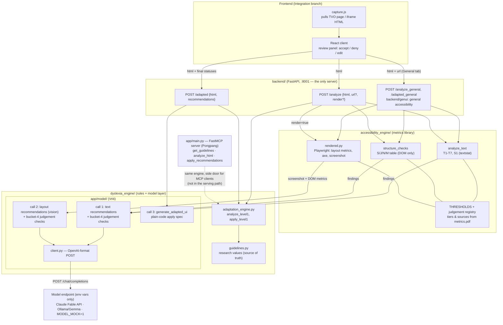

# Architecture (current)

One HTTP backend; `dyslexia_engine` and `accessibility_engine` are libraries inside
it, not separate services. Code measures (findings with citations), the model judges
(fixed, validated calls — plus registered bucket-4 judgements it raises itself),
the human decides, code applies.

## Flow

1. Capture tool extracts the TVO page/iframe HTML (or `render: true` lets the
   backend render a URL itself: layout metrics, axe run, screenshot).
2. `POST /analyze` → rule-engine recommendations (`analyze_level1`), plus
   `accessibility_engine` findings fed to model call 1 (and call 2 when rendered).
   The model also raises registered bucket-4 judgements, labeled
   `model judgement / <metric_id>`; a guard rejects unregistered ids. All `pending`.
3. The UI shows them with citations; the user accepts / denies / edits. **State
   lives in the frontend** — the backend is stateless.
4. `POST /adapted {html, recommendations}` → engine types via `apply_level1`,
   model text types via `generate_adapted_ui`. Returns adapted HTML + injected CSS.
   Send the same HTML as in step 2 — block ids (`p-4`) resolve against it.

## Why two pairs of endpoints

The review UI has a **General accessibility version** tab and a **Dyslexia version** tab. Until this
change, every recommendation for a captured page appeared in the Dyslexia tab and the General tab
was empty. The reasons, in the order they were found:

1. **One mixed list.** `POST /analyze` returned the dyslexia rule engine's recommendations
   (`analyze_level1`, evidence "Level 1 guideline ...") and, in the same list, model text
   recommendations driven by the general `accessibility_engine` metrics (long sentences, hard
   words). Nothing on a `Recommendation` says which audience it is for.
2. **One tab.** The client (`analysisReviewRepository.ts`) put that whole list into the version
   with id `dyslexia` and blanked the others, so general findings were shown as dyslexia ones.
3. **No route.** The general flow (`backend/genui`) had `analyze_general` / `apply_general` but
   no HTTP endpoint, no entry in `backendProxy.js` and no client call.
4. **No preview.** The client only knew the dyslexia types. General types (`T3`, `S1`, `J5`, ...)
   were dropped, and the `title`, `category`, `preview_html`, `preview_css` fields were ignored.
5. **Layout fixes never arrived.** Text size, line spacing and line length need a rendered page,
   which the client never asked for. When they were measured, the cap of 20 findings in the
   model prompt was filled by reading-level findings first, so they were cut. Rendering a
   captured page also hung: the snapshot server blocks scripts, and the axe script tag then
   never loads and never fails.

The fix keeps the two audiences apart from the backend to the tab:

| | Dyslexia version | General accessibility version |
|---|---|---|
| Analyse | `POST /analyze {html, rules_only: true}` | `POST /analyze_general {html, url, render: true}` |
| Apply | `POST /adapted` | `POST /adapted_general` |
| What it holds | dyslexia guideline rules (font, spacing, colour, columns, italics) | general metrics: typed page changes from the model, plus layout fixes computed in code |
| Client mapper | `suggestionsFromRecommendations` | `suggestionsFromGeneralRecommendations` |

- The client calls both analyses in parallel on the same HTML. Each fills only its own tab, and
  one failing leaves the other in place with a note saying what could not be run.
- `rules_only` skips the model call in `/analyze`: its text recommendations come from the
  general metrics, and those now arrive through `/analyze_general`. Without the flag
  `/analyze` behaves as before.
- **Computed layout fixes** (`backend/genui/computed.py`): for text size (L3), line spacing and
  justified text (L2) and line length (L1) the fix is the threshold itself, so code writes the
  CSS. They pass the same guardrails, are merged into one card per block, and are still
  returned when the model step fails. The findings cap now takes turns between metrics.
- Suggestion ids carry the version (`...#general-r1`), because both analyses number from `r1`
  and decisions are stored by id.
- The Dyslexia version is built on the General one, so its visitors also get the approved
  general changes.

## Contracts

- `Recommendation` (`app/schemas.py`) is the one shared object: frontend,
  engines, and model layer all speak it.
- Findings: `{metric_id, block_id, measured, threshold, source, tier, detail}` —
  thresholds/sources copied from `accessibility_metrics.THRESHOLDS`, never inlined.
- Model choice is environment only (`MODEL_BASE_URL`, `MODEL_NAME`,
  `MODEL_API_KEY`, `MODEL_TEMPERATURE`, or `MODEL_MOCK=1`) — see the root README.

## Known gaps

- Rendered metrics deferred: L7 style variance, L8 density, L9/L10 fold checks,
  and the paragraph-spacing half of L2.
- Bucket 2 (spaCy/embeddings) and bucket 3 (multi-page crawl) of the metrics map.
- Applying a model text edit replaces the block's text wholesale (drops inline
  tags inside the block).
- Levels beyond 1 are not implemented.
