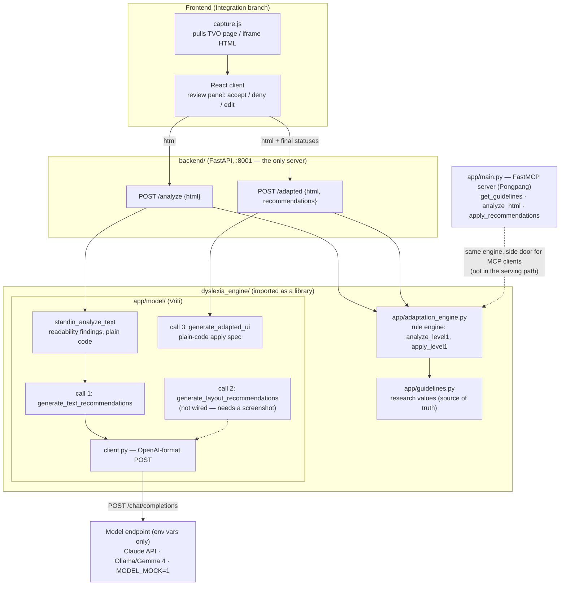

# Architecture (current)

One HTTP backend; `dyslexia_engine` is a library inside it, not a second service.
The model never calls tools — the backend makes fixed, validated calls and does the
deterministic work in plain Python.

## Flow

1. Capture tool extracts the TVO page/iframe HTML.
2. `POST /analyze {html}` → rule-engine recommendations (`analyze_level1`) plus
   model text recommendations (`standin_analyze_text` → call 1). All `pending`.
3. The UI shows them; the user accepts / denies / edits. **State lives in the
   frontend** — the backend is stateless.
4. `POST /adapted {html, recommendations}` → engine types via `apply_level1`,
   model text types via `generate_adapted_ui`. Returns adapted HTML + injected CSS.
   Send the same HTML as in step 2 — block ids (`p-4`) resolve against it.

## Contracts

- `Recommendation` (`app/schemas.py`) is the one shared object: frontend,
  engine, and model layer all speak it.
- Model choice is environment only (`MODEL_BASE_URL`, `MODEL_NAME`,
  `MODEL_API_KEY`, or `MODEL_MOCK=1`) — see the root README.

## Known gaps

- Rendered metrics deferred: L7 style variance, L8 density, L9/L10 fold checks,
  and the paragraph-spacing half of L2.
- Bucket 2 (spaCy/embeddings) and bucket 3 (multi-page crawl) of the metrics map.
- Applying a model text edit replaces the block's text wholesale (drops inline
  tags inside the block).
- Levels beyond 1 are not implemented.
