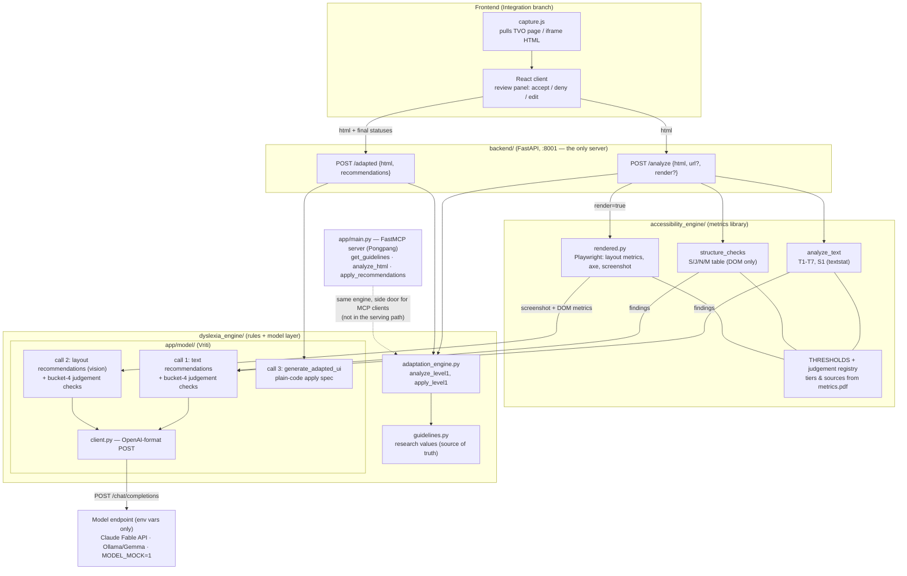

# Architecture (current)

One HTTP backend; `dyslexia_engine` and `accessibility_engine` are libraries inside
it, not separate services. Code measures (findings with citations), the model judges
(fixed, validated calls — plus registered bucket-4 judgements it raises itself),
the human decides, code applies.

## Flow

1. Capture tool extracts the TVO page/iframe HTML (or `render: true` lets the
   backend render a URL itself: layout metrics, axe run, screenshot).
2. `POST /analyze` → rule-engine recommendations (`analyze_level1`), plus
   `accessibility_engine` findings fed to model call 1 (and call 2 when rendered).
   The model also raises registered bucket-4 judgements, labeled
   `model judgement / <metric_id>`; a guard rejects unregistered ids. All `pending`.
3. The UI shows them with citations; the user accepts / denies / edits. **State
   lives in the frontend** — the backend is stateless.
4. `POST /adapted {html, recommendations}` → engine types via `apply_level1`,
   model text types via `generate_adapted_ui`. Returns adapted HTML + injected CSS.
   Send the same HTML as in step 2 — block ids (`p-4`) resolve against it.

## Contracts

- `Recommendation` (`app/schemas.py`) is the one shared object: frontend,
  engines, and model layer all speak it.
- Findings: `{metric_id, block_id, measured, threshold, source, tier, detail}` —
  thresholds/sources copied from `accessibility_metrics.THRESHOLDS`, never inlined.
- Model choice is environment only (`MODEL_BASE_URL`, `MODEL_NAME`,
  `MODEL_API_KEY`, `MODEL_TEMPERATURE`, or `MODEL_MOCK=1`) — see the root README.

## Known gaps

- Rendered metrics deferred: L7 style variance, L8 density, L9/L10 fold checks,
  and the paragraph-spacing half of L2.
- Bucket 2 (spaCy/embeddings) remains deferred. The GenUI library has an opt-in,
  bounded crawl for J7/J8 and report-only N4; J6, J13, N5, and N9 remain
  deferred because their measurement or action is underspecified (see
  `backend/genui/README.md`).
- Applying a model text edit replaces the block's text wholesale (drops inline
  tags inside the block).
- Levels beyond 1 are not implemented.
