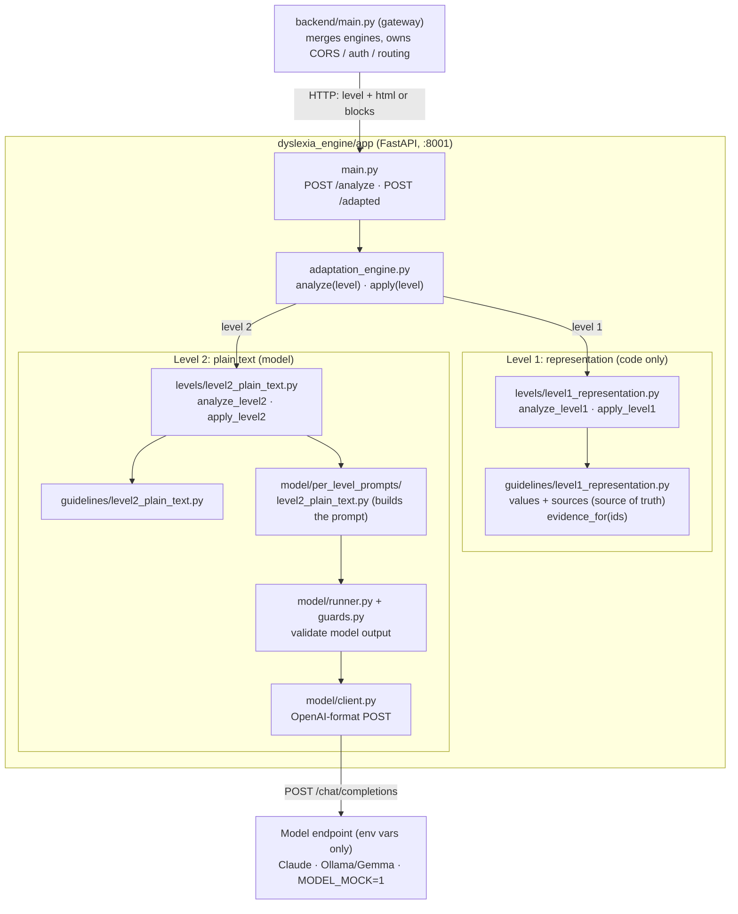

# Architecture: dyslexia_engine

`dyslexia_engine` is a standalone service (port 8001) that adapts a page for readers
with dyslexia. It is called over HTTP by `backend/main.py` (the gateway), which also
calls other engines such as `general_accessibility_engine`. This service knows nothing
about those engines or about the frontend.

Rules in code decide what is wrong, the model rewrites text (level 2 only), the human
decides, and code applies. Every recommendation carries its citation.



## Flow

1. The gateway sends `POST /analyze {level, html | blocks, enabled_rules?, max_recommendations?}`.
2. `adaptation_engine.analyze(level, ...)` routes by `level`:
   - **Level 1** takes an HTML string and runs `analyze_level1`. One recommendation per
     offending element (italics, underline, inline styles) plus one per page-wide rule
     group (typography, spacing, color, layout, emphasis). No model call.
   - **Level 2** takes text blocks `[{"block_id", "text"}]` and runs `analyze_level2`.
     It builds the prompt from `per_level_prompts/`, calls the model through
     `runner.py`, and guards check the output before it is returned.
3. The result is an `AnalyzeResult {level, recommendations, findings}`. Every
   recommendation is `pending`. Nothing has been changed yet.
4. The user accepts, denies or edits each one. **State lives in the frontend and the
   gateway**; this service is stateless.
5. The gateway sends `POST /adapted {level, html | blocks, recommendations}`. `main.py`
   keeps only `accepted` and `edited`, then `adaptation_engine.apply(level, ...)` routes:
   - **Level 1:** `apply_level1` edits elements and injects one `<style data-dyslexia-adapt>`
     with only the accepted page-wide sections. Returns `AdaptResult`.
   - **Level 2:** `apply_level2` applies the accepted text rewrites. Returns `Level2ApplyResult`.
6. Send the **same** `html` / `blocks` to both calls. Block ids (`p-4`) resolve against it.

## Level mapping

| Level | Input | Method | Model? | Entry points |
|---|---|---|---|---|
| 1 Representation | `html` | Deterministic CSS and element edits | No | `analyze_level1`, `apply_level1` |
| 2 Plain text | `blocks` | Model rewrites, validated by guards | Yes | `analyze_level2`, `apply_level2` |
| 3+ | n/a | Not implemented (`SUPPORTED_LEVELS = (1, 2)`) | n/a | n/a |

## Contracts

- `Recommendation` (`app/schemas.py`) is the one shared object between this engine, the
  model layer and the gateway.
- **Evidence comes from the guideline's own `source` field.** Level 1 builds it with
  `evidence_for("L1.1.7")`, which looks the id up in `guidelines/level1_representation.py`
  and returns e.g. `L1.1.7: Scope. (2023) ...`. Nothing is hard-coded in the analyzer.
  Add a guideline once and its citation follows everywhere.
- Level 1 numbers (font size, spacing, colors, line length) live only in
  `guidelines/level1_representation.py`.
- Model choice is environment only: `MODEL_BASE_URL`, `MODEL_NAME`, `MODEL_API_KEY`,
  `MODEL_TEMPERATURE`, or `MODEL_MOCK=1`. Loaded from `dyslexia_engine/.env`.
- Errors: `422` bad request (unsupported level, missing `html` / `blocks`),
  `502` model unavailable (level 2).

## Folder structure

```
dyslexia_engine/app/
├── main.py                 # HTTP wrapper (FastAPI); called by backend/main.py
├── schemas.py              # shared Recommendation / AnalyzeResult / AdaptResult
├── adaptation_engine.py    # thin orchestrator: analyze(level), apply(level)
├── guidelines/
│   ├── __init__.py         # get_guidelines(level=None)
│   ├── level1_representation.py   # values, sources, PAGE_RULES, evidence_for
│   └── level2_plain_text.py
├── levels/
│   ├── level1_representation.py   # analyze_level1, apply_level1
│   └── level2_plain_text.py       # analyze_level2, apply_level2
└── model/                  # model layer (shared plumbing + per-level prompts)
    ├── per_level_prompts/level2_plain_text.py   # builds the level 2 prompt
    ├── client.py, config.py, log.py, guards.py, runner.py
    ├── analyze_level2.py
    └── schemas.py, sample_data.py, standin_analyze_text.py
```

## Out of scope here (handled by the gateway or other engines)

- Calling and merging `general_accessibility_engine`.
- Rendering a URL with Playwright, screenshots, axe, layout metrics.
- CORS, auth, and combining adapted HTML from several engines.

## Known gaps

- Level 1 checks only the page's own CSS, not computed browser styles.
- Level 1 element ids (`<tag>-<n>`) shift after `<i>/<em>/<u>` are rewritten, so always
  apply against the HTML that was analyzed.
- Levels beyond 2 are not implemented.
- The old FastMCP server (`get_guidelines`, `analyze_html`, `apply_recommendations`) is
  no longer in `app/main.py`. Move it to its own file if MCP clients are still needed.